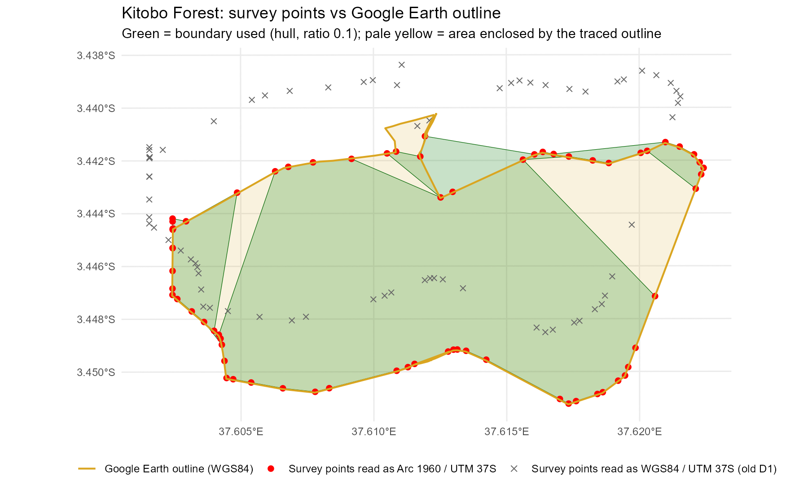
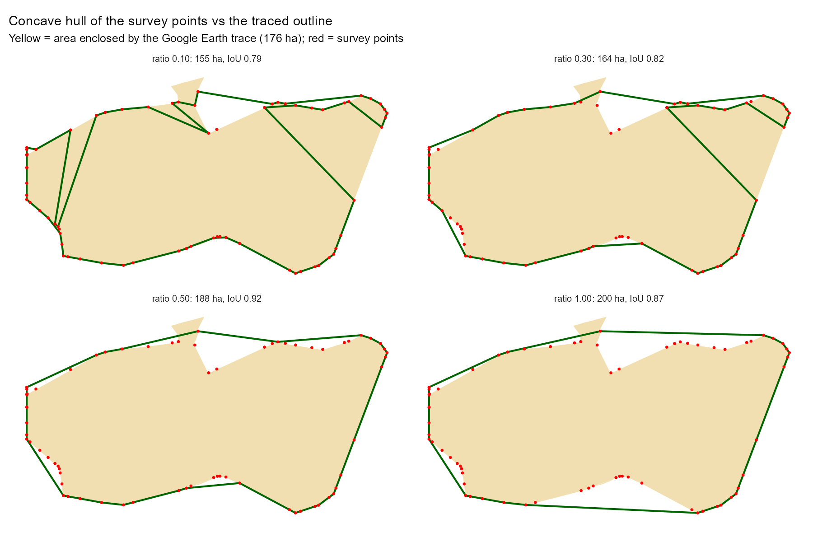

# Methodology & design decisions — Kitobo Forest Conservation Plan

This document records *why* the pipeline is built the way it is. Keep it in sync with the locked
decisions in `CLAUDE.md` §2. Figures are in `docs/figures/`. Numbers quoted here were produced by the
scripts in `scripts/` on 2026-10-23; the tables they come from are regenerated into `outputs/tables/`.

## Site

Kitobo Forest is a small **groundwater / riverine forest** near Taveta (Taita-Taveta County), about
2.2 km long by 1.2 km wide and centred at roughly 37.612°E, 3.446°S. It is fed by sub-surface water from
the Kilimanjaro volcanic aquifer that emerges as springs. This hydrological character drives several
method choices below.

It lies about 19 km from Tsavo West National Park and some 55 km west of the nearest TTWCA ranch or
settlement polygon, so the Tsavo ranch layers do not contain it (`outputs/tables/01_landscape_context.csv`).

## 1. Coordinate reference system

The surveyed boundary coordinates are **projected UTM** (eastings ≈ 345 km, northings ≈ 9,619 km), but
they are in **Arc 1960 / UTM zone 37S (`EPSG:21037`)**, the datum used by Survey of Kenya, and **not**
WGS84 / UTM 37S (`EPSG:32737`) as first assumed.

This was established by comparing the points with the operator's own Google Earth outline of the forest
(`Final Kitobo Forest.kml`; Google Earth is WGS84 by definition; 102 vertices). Distance from each of the
70 unique survey points to that outline:

| Points read as | Median distance | 90th percentile |
|---|---|---|
| Arc 1960 / UTM 37S (`EPSG:21037`) | **2.7 m** | 3.5 m |
| WGS84 / UTM 37S (`EPSG:32737`) | 249 m | 317 m |

Read as WGS84 the whole forest is displaced about 315 m to the north-north-west (≈ 97 m west, 299 m
north). That is the Arc 1960 → WGS84 datum shift at this location (PROJ gives +97 m east, −299 m north).

All metric operations (area, buffers, hydrology, GEE exports) use **WGS84 / UTM 37S (`EPSG:32737`)**; the
points are transformed from `crs_pts` to `crs_utm` as soon as they are read. Other project layers
(`*_wgs84.shp`, EPSG:4326) are transformed to match as needed. `01_boundary.R` repeats the check against the
outline on every run and warns if another CRS fits better.

## 2. Forest boundary

The 74 boundary points (70 unique) lie **only on the perimeter**, and they are not in perimeter order.
Constructions tested, with the area enclosed by the operator's traced outline as the reference
(`outputs/tables/01_hull_ratio_sensitivity.csv`; IoU = intersection over union with the outline):

| Construction | Area (ha) | IoU | Verdict |
|---|---|---|---|
| Join the points in CSV order | 96.4 | n/a | **Invalid** — self-intersects and undercounts (104.6 ha after repair) |
| Concave hull, ratio 0.10 | 154.6 | 0.79 | **Chosen (D2).** Matches the ~150 ha usually quoted, but misses 30 ha of the outline |
| Concave hull, ratio 0.30 | 164.2 | 0.82 | Misses 23 ha |
| Concave hull, ratio 0.50 | 187.7 | **0.92** | Best hull: misses 1.7 ha, but 12.9 ha lie beyond the outline |
| Convex hull (ratio 1.00) | 200.5 | 0.87 | Overshoots — bridges every concavity |
| **Operator's traced outline** (closed, noded, polygonized) | **176.5** | 1.00 | Reference |

Because the points are only on the perimeter, a concave hull with a low ratio cuts chords across the
interior wherever the points are sparse; the ratio that reproduces the quoted ~150 ha is therefore *not* the
ratio that best reproduces the forest's shape. The Google Earth trace is an ordered outline of the same forest
(every survey point lies within 3.5 m of it once the CRS is right). Closing it, noding it where it crosses
itself and polygonizing gives a single valid polygon of 176.5 ha, selectable with `params$boundary = "outline"`
in `00_setup.R`.

**Decision (D2), 2026-10-23:** having seen this comparison, the lead chose the **concave hull at ratio 0.10**
(154.6 ha) as the forest boundary, over the traced outline (176.5 ha) and a hull at ratio ≈ 0.5 (187.7 ha). The ratio
stays a single parameter (`params$hull_ratio`), so 0.5 is a one-line change; `params$boundary = "outline"` still
builds the traced polygon for comparison. Reports should say that the hull covers about 83% of the traced outline and
that 8 ha of the hull lie outside it. The original comparison figure (`figures/kitobo_hull_comparison.png`) shows the
convex, concave and CSV-order constructions.

## 3. Hydrology — DEM + WhiteboxTools over a buffered catchment

Surface channels are not reliably visible from satellite imagery here, so flow paths are derived from
a DEM using WhiteboxTools: breach depressions → D8 pointer → flow accumulation → extract streams →
Strahler order → vectorise; TWI from specific catchment area + slope. Slope/aspect/TPI/TRI come from
`terra::terrain`. This reuses the hydrological pipeline already built for the Tsavo West rhino work.

Two deliberate choices:
- **Buffered catchment (default 5 km), not the forest polygon.** The forest sits at the discharge end;
  flow paths originate upslope. Routing over 155 ha of flat ground gives a DEM almost nothing to
  work with.
- **"River starting points" = channel heads**, defined as the upstream-most nodes of the extracted
  stream network (first segment vertices not shared with any other vertex). Sensitive to the
  stream-initiation threshold, which is set as a **contributing area** (`params$stream_area_km2`) and converted to
  cells with the real DEM resolution.

**What the first run showed (2026-10-23).** `elevatr` at `z = 13` returns a 9.5 m grid over the 109 km² buffered
catchment (elevation 699–1,100 m), but it is interpolated from ~30 m SRTM-class data, so the real resolution is ~30 m.
The scaffold's default of 1,000 cells was therefore only 0.09 km² of contributing area and produced a web of
613 segments, 321 km of channel (drainage density 2.9 km/km²) and 327 channel heads, mostly DEM noise on a
flat plain. Raster-based estimates for other thresholds: 0.18 km² → ~1.8 km/km², 0.45 km² → ~1.2, 0.91 km² → ~0.8.
The default is now **1 km²** (a common choice for coarse DEMs), provisionally, until it is tuned against imagery and
known channels. At 1 km² the network has 58 segments, 98 km of channel (0.9 km/km²) and 35 channel heads, none inside
the forest; several ephemeral flow paths converge on the forest from the north and east
(`outputs/figures/02_hydrology.png`).

**Caveats (report these, don't drop them):**
- Modelled streams represent **surface runoff/erosion drainage**, *not* the springs that actually feed
  the forest. **TWI** — which flags saturation-prone zones — is the variable most likely to track
  water availability for the forest; pair it with any field-known spring locations.
- Over flat terrain, channel-head placement and drainage density are sensitive to DEM quality. For
  publication, prefer **FABDEM** (Copernicus GLO-30 with canopy/building bias removed) over `elevatr`'s
  blended tiles — canopy height inflates a DSM over forest and can create false flow barriers at the
  forest edge.

## 4. Fire — FIRMS for timing, Sentinel-2 dNBR for extent & severity

- **NASA FIRMS** (VIIRS active-fire, 375 m) pins down *when* the fire occurred. At 375 m a ~1.2 km-wide
  forest is only 1–3 pixels, so FIRMS is used for the **date**, not the extent. The area API accepts a
  **DAY_RANGE of 1 to 5 days** per call (checked against the API page on 2026-10-23; the first scaffold assumed
  10, which fails), so the year is swept in 5-day steps. Standard-processing (`_SP`) sources hold the archive but
  lag the present by months, so near-real-time (`_NRT`) sources are queried as well and the two are de-duplicated.
  Source: <https://firms.modaps.eosdis.nasa.gov/api/area/>.
- **Sentinel-2 dNBR** (10–20 m) maps extent and severity. NBR = (B8 − B12)/(B8 + B12);
  dNBR = NBR_pre − NBR_post (scaled ×1000); classified with Key & Benson thresholds. Pre/post windows
  bracket the FIRMS date. MODIS/VIIRS burned-area products (500 m) are **too coarse** for a forest this
  size and are not used. Following the UN-SPIDER burn-severity recommended practice:
  <https://github.com/UN-SPIDER/burn-severity>.

dNBR quality depends on a reasonably cloud-free pre/post Sentinel-2 pair; if the post window is cloudy,
widen it or step to the next clear scene.

**As run (2026-10-23).** The windows were 10 Jan–10 Feb 2026 (before) and 1 Mar–15 Apr 2026 (after), for a fire dated to
mid-February (the date is as given and has not been checked against FIRMS). 23.5% of the forest (36.3 ha of the
154.6 ha hull) has dNBR above 100: Low 12.9%, Moderate-low 9.0%, Moderate-high 1.3% and High 0.3% of the forest, so
93% of the burned area is low or moderate-low severity. The traced outline gives 35.4 ha (20.1%): the burned hectares
hardly depend on the boundary, only the share does (`outputs/tables/burn_by_boundary.csv`). The Key & Benson classes
are usable inside the forest, where the unburned ground is steady between the windows (median dNBR −2). Outside it the
savanna and fields green up as the long rains start (median dNBR −109), so the severity raster should not be read
outside the forest.

## 5. Regeneration

Post-fire recovery is tracked with the **monthly mean NBR** from a pre-fire baseline through the present (Oct 2025 to
Oct 2026). Whole-forest NBR is the wrong measure here: only 23.5% of the forest burned, and the series carries the
seasonal cycle of the rains, so its Theil-Sen slope after the fire is flat (−0.0006 NBR per month, p = 0.90). Recovery
is instead measured as the **gap between burned and unburned ground inside the forest**, which share vegetation and
season. Burned = at least half of the four 10 m severity cells in a 20 m NBR cell are burned (dNBR above 100);
unburned = none of them; mixed cells are left out.

Results (2026-10-23): the gap was +0.002 before the fire, so the unburned ground is a fair control. It fell to −0.36 in
March 2026 and was within 10% of its pre-fire value by June 2026, 3.5 months after the fire. The **Theil-Sen slope over
the recovery phase** (March to June, four months) is +0.125 NBR per month (p = 0.09; four points give a test with little
power). The slope is the median of all pairwise slopes against months since the fire (`params$fire_date`), so it stays
correct when cloudy months are missing; the p-value is the Mann-Kendall test from `trend::sens.slope`.

**Interpretation.** This is recovery of the *spectral signal* (green, moist cover), and it coincides with the long
rains. It does not show recovery of woody structure, species composition or the springs, which take years; a multi-year
baseline and field indicators would be needed for that.

In the Earth Engine export the monthly bands are named by month (`2025_10_01_NBR`, …) and months without a clear
scene are exported as masked placeholders, so the R side can read the dates from the band names.

## Open data sources

- Sentinel-2 Surface Reflectance (ESA/Copernicus) via Google Earth Engine.
- DEM: open terrain tiles via `elevatr`; FABDEM (University of Bristol) for canopy-corrected elevation.
- NASA FIRMS active-fire detections (VIIRS S-NPP / NOAA-20 / NOAA-21).
- Tsavo ranches/settled areas and Kenya admin/PA layers (operator's existing holdings).

## Tool references

- WhiteboxTools R frontend: <https://search.r-project.org/CRAN/refmans/whitebox/html/00Index.html>
- FIRMS area API: <https://firms.modaps.eosdis.nasa.gov/api/area/>
- UN-SPIDER dNBR recommended practice: <https://github.com/UN-SPIDER/burn-severity>
